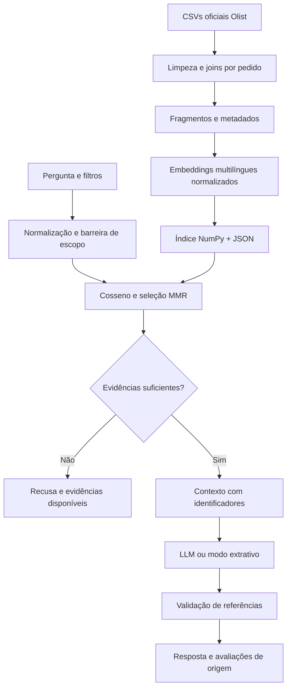

# Voice of Customer Intelligence com RAG

Projeto do Tech Challenge - Fase 4 (IAST): exploração das avaliações do **Brazilian E-Commerce Public Dataset by Olist** com recuperação semântica, filtros de contexto e respostas rastreáveis.

## O que a solução entrega

- Preparação da base oficial, preservando comentário, título, identificadores e metadados.
- Embeddings locais multilíngues com `paraphrase-multilingual-MiniLM-L12-v2`.
- Busca por similaridade de cosseno, filtros antes do ranking e diversidade por MMR.
- Interface Streamlit com notas, categorias, período da compra e atraso confirmado.
- **Modo LLM:** pipeline RAG completo, geração via endpoint compatível com chat completions e referências `[E1]` etc.
- **Modo extrativo:** recupera e exibe trechos reais sem geração. Útil para validar a busca sem serviço de LLM; sozinho não cumpre a etapa de geração exigida pelo desafio.
- Recusa diante de baixa similaridade, menos de duas avaliações, filtros sem resultados e alguns temas claramente fora do escopo.
- Testes automatizados, avaliação exploratória reproduzível e roteiro de apresentação.

## Execução rápida (Python 3.12)

```bash
python -m venv .venv
```

Ative com `.venv\Scripts\Activate.ps1` no PowerShell ou `source .venv/bin/activate` no Linux/macOS.

```bash
python -m pip install -r requirements.txt
python scripts/download_data.py
python -m voc.cli ingest --raw data/raw
streamlit run app.py
```

Para reproduzir as versões transitivas do ambiente Windows/CPU usado na validação, há `requirements-lock.txt`, que inclui o índice oficial de wheels CPU do PyTorch. O caminho padrão acima usa as dependências principais fixadas; o lock é uma referência mais estrita do ambiente testado.

Abra `http://localhost:8501`. A primeira indexação baixa o modelo do Hugging Face, requer internet e pode demorar em CPU. Os índices ficam em `data/index`; são locais e não são versionados. Cerca de 100 mil pedidos não significa 100 mil comentários válidos: a ingestão informa a quantidade efetiva.

Para um teste rápido: `python -m voc.cli ingest --raw data/raw --limit 3000`. A amostra usa as primeiras avaliações válidas na ordem do CSV, **não é aleatória nem representativa**. Reindexe sem `--limit` para explorar toda a base.

Para acelerar em CPU, use `python -m voc.cli ingest --raw data/raw --quantize`: quantização dinâmica int8 das camadas lineares. Essa escolha é registrada no manifesto e reaplicada à consulta. Ela pode alterar ligeiramente os vetores e deve ser avaliada nos resultados. `VOC_CPU_THREADS` controla paralelismo (padrão 1, adequado a ambientes com CPU limitada). O relatório informa se a execução usou quantização.

Se o download anônimo do Kaggle ficar indisponível, baixe os CSVs diretamente da [página oficial](https://www.kaggle.com/datasets/olistbr/brazilian-ecommerce/data) e coloque-os em `data/raw`. O arquivo de reviews é obrigatório; orders, order_items e products enriquecem os filtros. Nunca publique credenciais Kaggle.

## Ativar a geração por LLM

Uma opção local é instalar Ollama e disponibilizar um modelo capaz de responder em português e JSON:

```bash
ollama pull qwen2.5:7b
ollama serve
```

Se o serviço já estiver ativo, não é necessário iniciar outra instância. Configure no PowerShell:

```powershell
$env:LLM_BASE_URL='http://localhost:11434/v1'
$env:LLM_MODEL='qwen2.5:7b'
$env:LLM_API_KEY='ollama'
streamlit run app.py
```

No Linux/macOS use `export LLM_BASE_URL=...`. Selecione **Síntese com LLM** na interface. Também é possível usar outro servidor compatível, respeitando seu modelo, autenticação e suporte a `response_format=json_object`. `.env.example` é apenas referência: a aplicação lê variáveis do processo e **não carrega `.env` automaticamente**.

```bash
python -m voc.cli ask "O que os clientes relatam sobre atrasos na entrega?" --max-score 2 --mode llm
```

Sem um servidor LLM configurado, use `--mode extractive`. Falhas de geração aparecem explicitamente e mantêm as evidências disponíveis. A aplicação não apresenta uma resposta extrativa como se fosse uma síntese gerada.

Também há um backend Transformers local para reproduzir sem Ollama nem chave. Ele baixa os pesos do Hugging Face e roda em CPU, com maior latência. Exemplo PowerShell:

```powershell
$env:LLM_BASE_URL='local'
$env:LLM_MODEL='Qwen/Qwen2.5-0.5B-Instruct'
python -m voc.cli ask "O que os clientes relatam sobre atrasos na entrega?" --max-score 2 --mode llm
```

O backend local usa geração greedy, até 180 tokens e saída textual com citações. A aplicação extrai os marcadores e valida suas referências antes de construir o resultado estruturado. Já o endpoint remoto usa JSON. Modelos maiores podem melhorar a qualidade, com maior custo de memória e latência. No experimento inicial, o modelo 0,5B falhou ao escrever JSON, e o 1,5B com quantização apresentou repetição; essas saídas foram preservadas e bloqueadas. Por isso a geração local usa texto e **não aplica quantização por padrão**. `LLM_QUANTIZE=1` é experimental. Para pesos já baixados, `LLM_MODEL_PATH` pode apontar a uma pasta local compatível.

## Arquitetura



O índice usa busca vetorial exata em memória: para dezenas de milhares de comentários e 384 dimensões, é simples de reproduzir e não exige um banco externo. O arquivo `vectors.npy` armazena os vetores e `documents.json` liga cada linha ao fragmento. Escalas maiores justificam FAISS, pgvector ou outro índice ANN; aqui privilegia-se auditabilidade. Detalhes e limites em [docs/arquitetura.md](docs/arquitetura.md).

## Dados e decisões

Título e mensagem são combinados, HTML e espaços redundantes são removidos. Avaliações sem ambos os textos e notas inválidas são descartadas. Mantêm-se acentos, negações e erros linguísticos relevantes. Um identificador derivado de `review_id + order_id + texto` preserva reviews com ID repetido em pedidos diferentes e elimina duplicatas exatas. Categorias são conjuntos por pedido, evitando multiplicar reviews em joins com itens. Atraso compara as datas de entrega efetiva e estimada; entrega desconhecida permanece `null`.

Fragmentos de até 90 palavras, com sobreposição de 20, reduzem o risco de truncamento; o limite do tokenizer do modelo continua sendo uma restrição. MMR reduz redundância e a seleção impede duas evidências do mesmo documento. Notas são filtros de satisfação, não um classificador do sentimento do texto. O limiar padrão `0.30` e o mínimo de duas evidências são heurísticas ajustáveis, não uma garantia de resposta correta.

## Exemplos

| Pergunta | Exploração |
|---|---|
| O que os clientes relatam sobre atrasos na entrega? | Notas 1-2; opcionalmente atraso confirmado |
| Quais relatos existem sobre produtos quebrados ou com defeito? | Notas 1-2; evidências do texto |
| O que os clientes elogiam sobre a rapidez da entrega? | Notas 4-5 |
| Quais reclamações mencionam produto diferente do comprado? | Notas 1-2 |
| Qual a previsão do tempo amanhã? | Recusa por tema fora do escopo |

As respostas reais do modo extrativo estão em [evaluation/results.json](evaluation/results.json), quando geradas pela avaliação. Uma síntese LLM depende do modelo configurado e precisa ser validada pelo conteúdo citado. O top-k não permite concluir quais problemas são mais frequentes em toda a base. Para essa pergunta, seria necessário classificar ou codificar todos os comentários, com validação amostral e denominadores explícitos.

Exemplo realmente executado no backend local, para a pergunta sobre atrasos:

> [E1] Nota 1: Muita demora na entrega.
> [E2] Nota 1: Gostaria de esclarecimentos acerca da entrega que está em atraso.
> [E3] Nota 2: Compra Um demora pra entrega.

Essa saída foi produzida pelo Qwen 0,5B e ficou majoritariamente extrativa. A referência E1 corresponde ao review `bb2810db10122816078f39284c68f2d1`; todos os IDs, os textos e a saída bruta estão em [evaluation/llm-demo.json](evaluation/llm-demo.json). Não se presume capacidade analítica avançada desse modelo pequeno.

## Validação

```bash
python -m pytest -q
python scripts/evaluate.py --index data/index
```

Os testes usam um encoder controlado para verificar filtros, deduplicação, recusa, rastreabilidade, falhas de API e contrato de geração sem baixar modelos. O segundo comando executa busca semântica real; sua precisão lexical é um **proxy exploratório**, não uma métrica humana de relevância ou fidelidade. Consulte [docs/avaliacao.md](docs/avaliacao.md) e os resultados versionados.

## Docker

```bash
docker compose build
docker compose run --rm voc python scripts/download_data.py
docker compose run --rm voc python -m voc.cli ingest
docker compose up
```

O volume `./data` persiste o índice. Para Ollama no host, o compose aponta para `host.docker.internal:11434`. Variáveis podem ser ajustadas via ambiente ou pelo `.env` lido pelo Docker Compose. Docker é uma alternativa de reprodução; o resultado de validação descreve quais caminhos foram efetivamente testados.

## Organização

```text
app.py                 interface
voc/data.py            preparação e metadados
voc/retrieval.py       embeddings, persistência e busca
voc/pipeline.py        contexto, geração e guardrails
voc/cli.py             ingestão e perguntas pelo terminal
scripts/               download e avaliação
tests/                 testes independentes de modelos externos
evaluation/            perguntas e resultados reproduzíveis
docs/                  arquitetura, avaliação, apresentação e checklist
```

## Limitações e privacidade

Reviews podem conter dados pessoais; a limpeza mascara emails e telefones por padrões, mas não garante anonimização completa. Não há nomes de clientes nos joins usados. Avalie as evidências antes de enviá-las a um provedor externo. Os CSVs e índices não são publicados neste repositório. Validação de citações verifica existência e consistência das referências; não prova que toda afirmação é sustentada. A barreira de escopo cobre exemplos comuns e pode falhar em perguntas ambíguas. Revisão humana e um conjunto de avaliação anotado são os próximos passos.

## Entrega acadêmica

O código e a documentação estão preparados para execução e apresentação. Uma apresentação com narração sintética identificada e resultados reais está em [docs/apresentacao.mp4](docs/apresentacao.mp4). Confira a duração e os detalhes em [docs/video.md](docs/video.md). O [roteiro](docs/roteiro-video.md) também permite gravar uma versão pessoal. O checklist em [docs/entrega.md](docs/entrega.md) informa os itens entregues e os que dependem do responsável pela submissão. O bônus opcional Databricks depende de conclusão real da trilha pelo aluno e não é presumido.

## Referências

- [Olist / Kaggle: base oficial](https://www.kaggle.com/datasets/olistbr/brazilian-ecommerce/data).
- [Sentence Transformers: API e normalização de embeddings](https://www.sbert.net/docs/package_reference/sentence_transformer/model.html).
- [Modelo multilíngue e suas limitações](https://huggingface.co/sentence-transformers/paraphrase-multilingual-MiniLM-L12-v2).
- [Qwen2.5 1,5B: modelo de geração local](https://huggingface.co/Qwen/Qwen2.5-1.5B-Instruct).
- [Ollama: compatibilidade da API](https://docs.ollama.com/api/openai-compatibility).
- [Streamlit: documentação](https://docs.streamlit.io/).

O código é distribuído sob MIT. Os dados e modelos permanecem sujeitos às respectivas licenças; a licença do código não concede direitos sobre eles.
