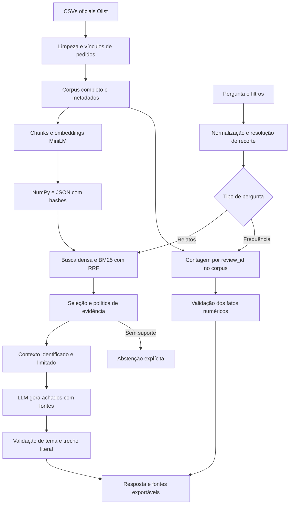

# Olist · Voice of Customer Intelligence com RAG

[](https://github.com/wilkerfc/Tech-Challenge-Fase-4-Voice-of-Customer-Intelligence-com-RAG/actions/workflows/tests.yml)

**Das avaliações de compra a respostas com fontes verificáveis.** Projeto do Tech Challenge — Fase 4 (IAST), usando a base pública **Brazilian E-Commerce Public Dataset by Olist**.

A solução permite investigar reclamações e elogios em português, aplicar filtros de contexto e conferir os comentários de origem. Perguntas sobre frequência usam uma camada analítica que conta avaliações únicas no corpus completo; respostas qualitativas usam recuperação semântica e lexical, contexto e LLM.

**[Vídeo da apresentação](docs/apresentacao.mp4)** · [Arquitetura e decisões](docs/arquitetura.md) · [Avaliação](docs/avaliacao.md) · [Requisitos do enunciado](docs/criterios-aceite.md) · [Notebook executado](notebooks/01_exploracao_e_decisoes.ipynb)

## Entregas e comportamento

| Necessidade | Implementação |
|---|---|
| Encontrar relatos relevantes | Embeddings multilíngues MiniLM + BM25 com fusão RRF; filtros antes do ranking; textos repetidos removidos |
| Responder com fontes | LLM seleciona achados com tema, citação e trecho; aplicação confere a cópia literal e renderiza a resposta |
| Investigar padrões | Temas lexicais contados sobre todos os `review_id` textuais elegíveis; denominador, cobertura e sobreposição explícitos |
| Explorar contexto | Nota, compra, categoria, UF e situação da entrega, pela interface ou por linguagem natural |
| Não fabricar resposta | Estados distintos de fora do escopo, nenhuma evidência, evidência insuficiente e falha de geração |
| Reproduzir e auditar | Hashes dos dados/índice, versões fixadas, testes, notebook, comparação pareada e resultados reais exportados |

## Executar no Windows — Python 3.12

Na pasta do projeto, execute **uma linha de cada vez**. Estes comandos funcionam no CMD e no PowerShell e dispensam ativação do ambiente:

```text
python -m venv .venv
.venv\Scripts\python.exe -m pip install --no-cache-dir -r requirements-lock.txt
.venv\Scripts\python.exe scripts/download_data.py
.venv\Scripts\python.exe -m voc.cli ingest --raw data/raw --quantize
.venv\Scripts\python.exe -m streamlit run app.py
```

Abra `http://localhost:8501`. Download dos dados/modelos requer internet; a primeira indexação em CPU demora. Para Linux/macOS, crie o ambiente, ative com `source .venv/bin/activate` e execute os mesmos comandos com `python` no lugar de `.venv\Scripts\python.exe`. O lock registra o ambiente CPU validado; `requirements.txt` fixa as dependências principais. Docker é uma alternativa descrita abaixo, sem execução validada nesta entrega.

O comando acima reproduz a quantização dinâmica int8 do **encoder** usada nos resultados. Omita `--quantize` para embeddings float32, mas reavalie a recuperação nessa configuração. O manifesto registra essa escolha e a consulta usa a mesma variante. `VOC_CPU_THREADS` controla as threads (padrão 1).

Para um smoke test menor, acrescente `--limit 3000` à ingestão. Essa seleção segue a ordem do CSV, não representa uma amostra aleatória; omita o limite e reconstrua para analisar toda a base. Dados, índices e pesos não são versionados.

Se o download anônimo falhar, obtenha os CSVs na [página oficial da Olist no Kaggle](https://www.kaggle.com/datasets/olistbr/brazilian-ecommerce/data). Reviews é obrigatório; orders, items, products e customers enriquecem os metadados. Da tabela de clientes usa-se somente a UF, sem nomes, IDs de clientes ou endereço no índice.

## Geração real com LLM

A aplicação oferece **Explorar evidências** (extrativo, sem LLM) e **Síntese verificada com LLM**. O modo extrativo é útil para inspecionar a recuperação; sozinho não demonstra a etapa gerativa exigida no desafio.

Para executar em CPU sem chave nem serviço externo, configure no **PowerShell**:

```powershell
$env:LLM_BASE_URL='local'
$env:LLM_MODEL='Qwen/Qwen2.5-0.5B-Instruct'
.venv\Scripts\python.exe scripts/demo_llm.py
.venv\Scripts\python.exe -m streamlit run app.py
```

No **CMD**, configure cada variável em uma linha:

```bat
set "LLM_BASE_URL=local"
set "LLM_MODEL=Qwen/Qwen2.5-0.5B-Instruct"
.venv\Scripts\python.exe scripts/demo_llm.py
```

O modelo pequeno é uma opção de reprodução com maior limitação de qualidade. O backend usa geração greedy, até 180 tokens e exemplos do contrato no prompt. Pesos já baixados podem ser apontados por `LLM_MODEL_PATH`. A quantização do **LLM** fica desabilitada por padrão; a opção experimental `LLM_QUANTIZE=1` não é recomendada pelos experimentos registrados.

Também há endpoint compatível com chat completions, por exemplo Ollama. Disponibilize o modelo no serviço e configure `LLM_BASE_URL=http://localhost:11434/v1`, `LLM_MODEL=qwen2.5:7b` e `LLM_API_KEY=ollama`. O endpoint precisa aceitar JSON em `response_format`. Esse caminho possui testes de contrato com mock; não foi validado com serviço real neste ambiente. `.env.example` documenta variáveis, mas o processo Python não carrega `.env` automaticamente.

**Contrato de geração:** o LLM organiza até três achados `{theme, citation, quote}` (até dois no prompt local). O verificador rejeita fontes inexistentes, trechos inventados ou atribuídos à fonte errada, temas sem sinal no trecho, campos livres e recusas contraditórias. A resposta é renderizada com descrições neutras e as citações literais. Isso privilegia rastreabilidade e restringe a expressividade; não é uma síntese livre nem um verificador universal de entailment. Os comentários continuam sendo alegações dos consumidores, não fatos operacionais comprovados. Veja entrada, saída bruta e resultado em [evaluation/llm-demo.json](evaluation/llm-demo.json).

## Exemplos para investigar

| Pergunta | Caminho |
|---|---|
| O que os clientes relatam sobre atrasos na entrega? | RAG; filtre notas 1–2 se desejar |
| Quais relatos mencionam produtos quebrados ou com defeito? | RAG com fontes do comentário |
| O que elogiam sobre a rapidez da entrega? | RAG; notas 4–5 são um filtro opcional |
| Quais os temas mais frequentes nas avaliações com notas 1 e 2 em SP? | Análise de todas as avaliações textuais elegíveis |
| Quantas avaliações mencionam atraso em 2018? | Contagem lexical, período da compra e denominador explícitos |
| O que relatam sobre entrega em 2099? | Sem evidências no recorte histórico |
| Qual a previsão do tempo amanhã? | Fora do escopo |

Filtros manuais e inferidos são combinados por **interseção**; conflitos geram uma mensagem, sem ampliar o recorte silenciosamente. A interpretação é exibida na interface e no JSON. O extrator é baseado em regras, com vocabulário limitado; períodos relativos exigem datas explícitas. Menção textual a atraso e atraso confirmado pelas datas são conceitos distintos.

Pelo terminal:

```text
python -m voc.cli ask "O que relatam sobre atraso?" --max-score 2 --mode llm --output resultado.json
python -m voc.cli ask "Quais os temas mais frequentes nas avaliações com notas 1 e 2 em SP?"
python -m voc.cli ask "O que dizem sobre embalagem?" --state SP --date-from 2018-01-01 --algorithm hybrid
```

## Arquitetura



MiniLM gera vetores normalizados de 384 dimensões. Para 42 mil documentos, a busca exata em memória evita um serviço adicional; o índice não é aproximado. BM25 captura termos específicos, RRF combina rankings e a deduplicação evita repetir o mesmo texto. MMR e cross-encoder são opções explícitas; o padrão usa **híbrido sem MMR**, selecionado no conjunto de desenvolvimento. O reranker tem teste de integração controlado, sem benchmark real com seus pesos. O limiar de cosseno `0.30` e o mínimo de duas avaliações únicas são heurísticas, não probabilidades calibradas.

## Preparação e unidade de contagem

Execução sobre os CSVs oficiais: **99.224 linhas lidas, 56.537 sem texto, 42.687 documentos textuais e 42.370 `review_id` textuais únicos**. Título e mensagem são combinados, HTML e espaços redundantes são removidos, acentos/negações são preservados e padrões de email/telefone são mascarados. Isso não garante anonimização completa. Notas inválidas e duplicatas exatas são rejeitadas, sem inventar comentários ausentes.

Um ID derivado de `review_id + order_id + texto` preserva vínculos reais e variantes. Itens viram conjuntos de categorias por pedido, evitando multiplicação nos joins. Há **307 avaliações ligadas a mais de um pedido**. Filtros de UF, categoria, data e entrega precisam coincidir no mesmo pedido associado; `matching_orders` registra quais satisfazem o recorte. O texto não identifica necessariamente a qual pedido se refere.

Analytics reúne as variantes e conta cada `review_id` uma vez. Temas usam regras lexicais versionadas, com sobreposição e cobertura explícitas; não são um classificador de causas validado por humanos. Avaliações sem texto ficam fora do denominador. Percentuais não são publicados em grupos menores que 30 avaliações; esse mínimo é uma política do protótipo, não uma garantia estatística. Números e texto da resposta analítica são renderizados dos mesmos fatos, sem prosa numérica livre do LLM.

O índice schema 2 guarda SHA-256 de documentos, corpus e vetores e recusa alterações acidentais. Textos/IDs/ordem alterados exigem reindexação. Para atualizar somente metadados de um índice compatível: `python scripts/refresh_metadata.py --data data/raw --dry-run`, depois repita sem `--dry-run`. As revisões padrão dos pesos são fixadas: MiniLM `e8f8c211226b894fcb81acc59f3b34ba3efd5f42` e Qwen 0,5B `7ae557604adf67be50417f59c2c2f167def9a775`.

## Avaliação reproduzível

| Conjunto e unidade | Legado denso + MMR | Híbrido RRF padrão |
|---|---:|---:|
| 16 perguntas de desenvolvimento · precisão silver@6 | 58,33% | 67,71% |
| 8 perguntas reservadas · precisão silver@6 | 77,08% | 81,25% |
| 8 perguntas reservadas · MRR silver | 0,9375 | 0,9167 |

A precisão usa relevância automática por regex nos textos e divide pelo `k` solicitado. As mesmas perguntas, filtros, vetores e corpus são usados em cada comparação. O padrão foi congelado antes das oito perguntas reservadas. Há ganhos e perdas por consulta; a queda de MRR também é publicada. O conjunto é pequeno, relacionado aos temas de desenvolvimento e não possui anotação humana independente. Regex podem favorecer BM25; os números **não medem precisão geral, fidelidade do LLM nem superioridade sobre outro repositório**. Tabelas por pergunta, fontes e limites estão nos [resultados de desenvolvimento](evaluation/retrieval-benchmark.md) e [validação reservada](evaluation/retrieval-holdout.md).

```text
python -m pytest -q
python scripts/run_notebook.py --raw data/raw
python scripts/evaluate_retrieval.py --help
python scripts/evaluate_scenarios.py
python scripts/demo_llm.py
python scripts/check_ui.py
```

Os 89 testes automatizados cobrem filtros, identidade e ausentes, contagens/denominadores, corrupção de índice, citações, trechos, recusa e falhas de API. Usam encoders e reranker controlados; a recuperação real é avaliada separadamente. Os [cenários reais](evaluation/scenarios.json) verificam rotas e estados sem LLM. [O relatório de validação](evaluation/validation.md) distingue os caminhos executados, mocks e limitações. Não existe auditoria humana nova de relevância ou fidelidade.

## Docker e organização

```text
docker compose build
docker compose run --rm voc python scripts/download_data.py
docker compose run --rm voc python -m voc.cli ingest --quantize
docker compose up
```

O volume `./data` persiste dados/índice. Compose aponta para Ollama em `host.docker.internal:11434`; ajuste conforme o ambiente. Docker não foi executado nesta validação.

```text
app.py          interface Streamlit
voc/            dados, consulta, busca, análise, geração e CLI
scripts/        download, notebook, avaliações e verificação da interface
tests/          testes sem download de modelos
notebooks/      exploração executada, com contagens e decisões
evaluation/     perguntas, resultados, proveniência e limitações
docs/           arquitetura, critérios de aceite e apresentação
```

## Entrega, limites e licenças

O [vídeo](docs/apresentacao.mp4) apresenta resultados executados com narração sintética identificada; [detalhes e duração](docs/video.md). O [mapa de critérios](docs/criterios-aceite.md) cobre o enunciado. A submissão no ambiente acadêmico e a comprovação opcional da trilha Databricks cabem ao aluno.

A base histórica não descreve a operação atual. O filtro de escopo é limitado e perguntas ambíguas podem recuperar comentários inadequados. Literalidade reduz invenção, mas não comprova relevância, veracidade do consumidor ou a qualidade de toda interpretação. Antes de enviar evidências a um provedor externo, considere dados pessoais residuais e as condições de uso. Recomendam-se avaliação humana independente e conjuntos maiores para uso operacional.

Código sob [MIT](LICENSE). Dados Olist sujeitos a **CC BY-NC-SA 4.0**, conforme a página da base; não são relicenciados pelo código. Pesos e serviços têm suas próprias licenças.

Referências: [Olist/Kaggle](https://www.kaggle.com/datasets/olistbr/brazilian-ecommerce), [Sentence Transformers](https://www.sbert.net/), [MiniLM multilíngue](https://huggingface.co/sentence-transformers/paraphrase-multilingual-MiniLM-L12-v2), [Qwen2.5 0,5B](https://huggingface.co/Qwen/Qwen2.5-0.5B-Instruct), [Ollama](https://docs.ollama.com/api/openai-compatibility), [Streamlit](https://docs.streamlit.io/).
