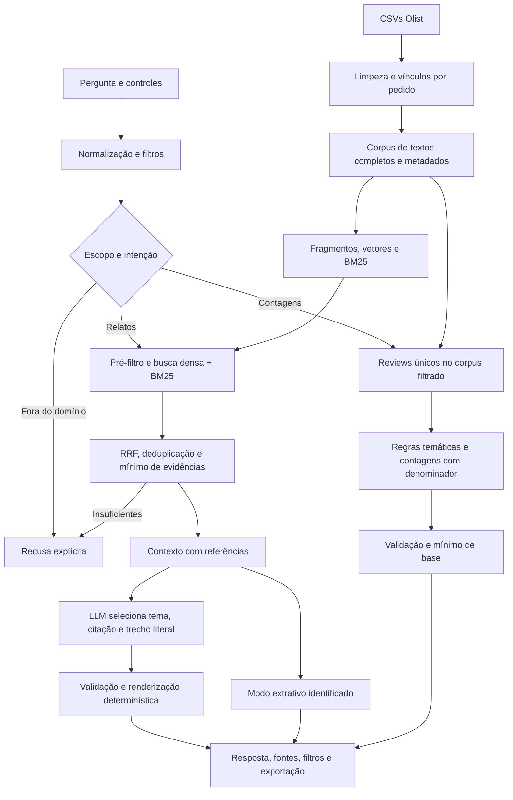

# Arquitetura, unidades de análise e decisões técnicas

A solução separa duas perguntas de negócio: **quais relatos sustentam uma investigação** e **quantas avaliações textuais mencionam um tema**. A primeira usa recuperação semântica e, quando configurado, um LLM com saída restrita. A segunda calcula contagens sobre o corpus completo filtrado; não transforma top-k em estimativa de frequência.



O roteamento e os filtros são transparentes em `resolved_query`. É possível escolher explicitamente a rota RAG ou analítica. A rota automática é uma heurística linguística, não um classificador universal de intenção.

## 1. Preparação e identidade

`voc/data.py` lê os CSVs em UTF-8, combina título e mensagem, remove HTML e espaços excedentes e mascara alguns padrões de email e telefone. Preserva acentos, negações e erros linguísticos. Reviews sem título e mensagem são descartados, sem imputar texto a partir da nota; notas fora de 1–5 também são rejeitadas.

O corpus validado contém **42.687 documentos textuais**, derivados de **99.224 linhas de reviews**, após descartar **56.537 linhas sem texto**. Há **42.370 `review_id` textuais distintos** e **307 reviews textuais ligados a mais de um pedido**. As contagens e os hashes reais podem ser inspecionados no notebook `notebooks/01_exploracao_e_decisoes.ipynb`; essas unidades não são intercambiáveis.

Um documento preparado usa a combinação `review_id + order_id + texto limpo` como identidade. Assim, um ID de review presente em pedidos distintos não desaparece por deduplicação prematura. Duplicatas exatas dessa combinação são removidas. Textos iguais em pedidos diferentes podem ser relatos legítimos e continuam no corpus; a busca evita exibir cópias do mesmo texto na seleção top-k.

Reviews são associados a pedidos, itens e categorias. A tabela de clientes fornece somente UF; não são usados nomes de clientes, pagamentos ou geolocalização detalhada nesses joins. Categorias são conjuntos por pedido para evitar que um pedido com vários itens multiplique a avaliação. Um comentário sobre pedido multicategoria não é atribuído automaticamente a um produto específico.

Cada documento mantém seu vínculo principal e também `order_ids`/`order_metadata`, com todos os pedidos associados ao review. Essa representação permite aplicar filtros combinados ao **mesmo pedido**, em vez de satisfazer UF em um pedido e período em outro. Na análise agregada, cópias e variantes de texto são reunidas por `review_id`, preservando vínculos e notas; valores de nota conflitantes não são substituídos arbitrariamente.

## 2. Semântica dos metadados

| Campo | Interpretação |
|---|---|
| `score` / `scores` | Nota declarada. Notas baixas são um recorte de satisfação; não comprovam causa nem sentimento do texto |
| `purchase_date` | Data da compra usada nos filtros temporais, com limites inclusivos |
| `review_date` | Data da avaliação, preservada para rastreabilidade; não substitui a data da compra |
| `categories` | Categorias dos itens do pedido; podem ser múltiplas e se sobrepor |
| `state`, `uf`, `states` | UF do vínculo de pedido e UFs dos vínculos preservados; filtros usam os metadados de cada pedido |
| `delivery_status` | Estado operacional definido pelas regras abaixo, distinto de reclamação textual |
| `matching_orders` | Pedidos que satisfizeram conjuntamente os filtros aplicados |

`delivery_status` distingue quatro estados:

- `late`: existem datas de entrega efetiva e estimada, e a data efetiva é posterior à estimada.
- `on_time`: existem as duas datas, e a entrega não é posterior à estimativa.
- `not_delivered`: falta entrega efetiva e o pedido está explicitamente `canceled` ou `unavailable`.
- `unknown`: os dados disponíveis não sustentam os estados anteriores. Ausência de data, sozinha, não é tratada como não entrega ou pontualidade.

A comparação de atraso usa dias de calendário. Uma reclamação de demora pode existir mesmo quando o registro operacional indica entrega dentro da estimativa. Datas faltantes permanecem desconhecidas. Esses conceitos são exibidos separadamente e não são usados como prova de causalidade.

## 3. Pergunta, filtros e intenção

`voc/query.py` aplica NFKC e normalização de espaços e interpreta padrões explícitos em português: nota ou intervalo de notas, referências a insatisfação, anos/meses/datas, categorias conhecidas, UF e situações de entrega. “Insatisfeitos”, “negativas” e “nota baixa” significam notas 1–2, com essa convenção registrada nas notas da consulta. Elogios não impõem, por si só, uma nota alta.

Datas relativas sem referência absoluta não são inventadas: a consulta informa a limitação e pede datas explícitas. Aliases de categoria e nomes de estados são regras publicadas no módulo, não compreensão irrestrita de linguagem natural.

Filtros inferidos e controles manuais são combinados por **interseção**. Uma nota padrão de 1–5 na interface não amplia o intervalo pedido na pergunta. Intervalos, UFs, categorias ou situações conflitantes geram erro, em vez de mudar silenciosamente a população. Filtros de pedido são conjuntivos no mesmo vínculo, compartilhando o predicado `matches_filters` entre recuperação e análise agregada. Para um review com notas conflitantes, todos os valores preservados precisam satisfazer o intervalo solicitado.

Termos como “quantas”, “frequência”, “principais” e “padrões” encaminham a rota automática para analytics. Essa regra pode errar em consultas ambíguas; a interface e a CLI permitem escolher a rota e inspecionar a decisão.

## 4. Armazenamento e integridade

O índice mantém:

- `documents.json`: fragmentos com metadados e referências de origem.
- `vectors.npy`: uma linha por fragmento, com vetores float32 normalizados.
- `corpus.json`: documentos com textos completos, usados pela camada analítica.
- `manifest.json`: modelo, variante quantizada, dimensão, contagens, versão do esquema e hashes SHA-256 dos arquivos.

O modelo é `sentence-transformers/paraphrase-multilingual-MiniLM-L12-v2`, com **384 dimensões** nesta execução. A variante validada usa quantização dinâmica int8 de camadas lineares do encoder em CPU; os vetores continuam float32. O manifesto registra a variante e a consulta recarrega a mesma configuração. A quantização pode alterar similaridades; os resultados pertencem à variante realmente executada.

Os fragmentos têm até 90 palavras, com passo de 70, para sobreposição de 20 quando há fragmentação. Neste corpus os comentários são curtos; contagem de palavras não é contagem de tokens, nem garantia universal contra truncamento pelo tokenizer. O notebook mostra a distribuição de tamanhos real.

O esquema 2 verifica hashes, quantidade de linhas, dimensão e valores finitos antes de usar o índice. `refresh_metadata` só reutiliza vetores quando IDs, ordem, fragmentos e textos permanecem exatamente iguais; alteração textual exige reconstrução. `corpus.json` mantém textos completos separados dos chunks para que fragmentação não multiplique a população analítica.

Os hashes detectam mudanças em relação ao manifesto local; não constituem assinatura, certificação de procedência ou proteção contra alguém capaz de substituir também o manifesto. A origem dos CSVs é documentada separadamente no download e na proveniência.

## 5. Recuperação híbrida e alternativas

O padrão é **busca híbrida densa + BM25, combinada por Reciprocal Rank Fusion (RRF), sem MMR e sem reranker**. Essa configuração foi escolhida no conjunto de desenvolvimento e mantida nas perguntas holdout; os limites e resultados estão em `docs/avaliacao.md`.

O fluxo em `voc/retrieval.py` é:

1. Selecionar fragmentos que atendam aos filtros de metadados.
2. Codificar a pergunta com o mesmo encoder do índice e calcular cosseno por produto escalar dos vetores normalizados.
3. Obter candidatos densos e lexicais entre os elegíveis, com pool padrão de 100 por ranking. BM25 usa estatísticas do índice inteiro, normalização leve do português, `k1=1.5` e `b=0.75`; não é um stemmer linguístico completo.
4. Fundir os rankings com `RRF(d) = soma(1 / (60 + posição_do_documento))`. Um score BM25 só participa do ranking lexical quando é positivo.
5. Aplicar cosseno mínimo 0,30 e remover repetições do mesmo documento ou do texto normalizado. O limiar continua sendo **cosseno denso**, mesmo quando a ordem vem de RRF; ele não é probabilidade de relevância.
6. Selecionar até k evidências, padrão 6, preservando `similarity`, ranks, scores BM25/RRF, método e pedidos que satisfizeram os filtros.

MMR é uma alternativa explícita, com `lambda=0.8`: `lambda * relevância - (1-lambda) * maior similaridade com um selecionado`. No caminho híbrido usa relevância derivada de RRF; no denso usa cosseno. As variantes com MMR foram comparadas no benchmark automático, mas não foram escolhidas como padrão; não há alegação de que diversidade sempre melhore relevância.

O reranker cross-encoder `cross-encoder/mmarco-mMiniLMv2-L12-H384-v1` é opcional e só carrega pesos quando solicitado. Há testes controlados de contrato e ordenação. A entrega não contém benchmark real desse modelo de reranking, portanto não atribui a ele melhora ou custo medidos.

## 6. Contexto e geração restrita

A rota RAG exige pelo menos **dois `review_id` distintos** depois da seleção e do orçamento de contexto. Isso é uma barreira conservadora, não demonstração de relevância, suficiência semântica ou recorrência populacional. Até 10 mil caracteres de evidências serializadas entram no contexto, com citação, texto e metadados de origem.

No modo extrativo, a aplicação mostra os trechos recuperados e identifica que não houve geração. No modo LLM, o modelo seleciona até três achados com **tema, referência e trecho literal**. A saída HTTP deve ser JSON:

```json
{"findings":[{"theme":"atraso","citation":"E1","quote":"Trecho copiado exatamente da fonte."}],"insufficient":false}
```

O exemplo mostra apenas o formato; o trecho precisa existir na fonte. O backend local Transformers usa uma linha `tema | E1 | trecho literal` por achado, ou `SEM_EVIDENCIAS`. `parse_local` converte a saída para o mesmo contrato. O backend HTTP é compatível com chat completions e depende do serviço/modelo configurado. `LLM_BASE_URL`, `LLM_MODEL` e demais variáveis são descritas no README; arquivos `.env` não são carregados automaticamente pela aplicação.

`validate_generation` rejeita campos extras, prosa livre, referências inexistentes, temas desconhecidos e recusa com achados. O trecho deve ter de 8 a 900 caracteres e existir literalmente na fonte citada. Há uma normalização restrita: se a saída não for substring, o validador pode remover somente pontuação terminal (`.!?…`) e exige que todo o conteúdo restante seja substring literal. Não corrige palavras, números nem pontuação interna; o resultado registra `quote_normalization` como `none` ou `removed_terminal_punctuation`. O trecho publicado continua sendo literal da fonte.

O tema deve satisfazer uma regra lexical no próprio trecho; o tema genérico `outros` tem rótulo neutro. A aplicação renderiza o resultado validado com frases fixas e citações. Números do modelo fora do trecho não são publicados. Números que realmente fazem parte da fala citada podem permanecer como relato, sem se tornarem medição do sistema.

Os rótulos descrevem o assunto de forma neutra para não afirmar automaticamente polaridade, causa ou ocorrência operacional. Ainda há limites: uma frase negada pode conter a palavra de um tema, uma fonte pode fazer uma alegação falsa, e seleção literal não prova que o trecho responde adequadamente à pergunta. O contrato reduz a expressividade e a superfície de afirmações livres, mas **não é verificação universal de entailment** nem garantia contra toda prompt injection.

Fontes são dados não confiáveis. O prompt determina que suas instruções sejam ignoradas, não há ferramentas executadas pelo LLM, e os trechos são escapados para exibição. Timeout, falha de serviço, formato inválido ou achado rejeitado produzem `generation_failed`, mantendo as fontes disponíveis e sem apresentar a falha como síntese bem-sucedida.

O backend local usa geração greedy, até 180 tokens e pesos float32 por padrão. `LLM_QUANTIZE=1` é experimental; `LLM_MODEL_PATH` permite reutilizar pesos locais. `VOC_CPU_THREADS` controla as threads. A adequação de um modelo e a qualidade de suas saídas precisam ser demonstradas com execuções reais, não inferidas do suporte ao protocolo.

## 7. Análise agregada sobre o corpus

`voc/analytics.py` agrupa o corpus por `review_id`, preservando todas as variantes de texto e os pedidos associados. Rejeita entrada com chunks para evitar contar fragmentos como avaliações. Aplicam-se os mesmos filtros e, para cada tema, conta-se no máximo uma ocorrência por review elegível.

A taxonomia versionada `lexical-2026-10-v2` usa regras inspecionáveis para menções a problemas, elogios e assuntos neutros. Algumas regras aplicam uma janela explícita de negação; isso não representa um classificador validado de sentimento. Erros linguísticos, ironia, negações complexas e paráfrases podem causar falsos positivos ou negativos.

Cada resultado expõe denominador, unidade `unique_textual_reviews`, filtros, versão da taxonomia, IDs contados, regra e exemplos. Um review pode receber vários temas: **os percentuais se sobrepõem e não devem ser somados**. A cobertura conta a união dos reviews em todos os temas selecionados, embora a resposta mostre por padrão até cinco temas. Os exemplos citados ilustram contagens calculadas sobre todas as avaliações elegíveis; não são a amostra usada como denominador.

O mínimo operacional para publicar percentuais é **30 reviews textuais únicos no recorte**. Abaixo disso, o resultado sinaliza insuficiência e os percentuais ficam `null`; não se inventa uma taxa nem se apresenta uma base pequena como estável. Esse mínimo é uma política do protótipo, não um tamanho amostral calculado ou garantia estatística.

Contagens, taxas e texto são produzidos deterministicamente, sem LLM. `validate_analytics` verifica unicidade dos IDs contados, contagens, percentuais, cobertura, regras/labels da taxonomia, pertencimento dos exemplos aos temas e a correspondência do texto à renderização canônica. Isso verifica consistência, não a verdade semântica das regras. Os percentuais referem-se somente ao corpus textual filtrado, não a todos os pedidos, clientes ou vendas da Olist.

## 8. Insuficiência, observabilidade e operação

Os resultados distinguem `ok`, `no_evidence`, `insufficient_evidence`, `out_of_scope` e `generation_failed`. Entrada vazia, longa demais ou filtros conflitantes geram validação explícita. A barreira de escopo cobre expressões conhecidas, mas perguntas ambíguas ou fatos ausentes podem exigir recusa adicional pelo LLM. O limiar 0,30 e o mínimo de dois reviews não foram calibrados como detector universal.

A interface permite inspecionar rota, filtros efetivos, método de recuperação, fontes e análise estruturada, e exporta o resultado JSON. O tempo de uma consulta é registrado, sem equivaler a um benchmark de concorrência ou a garantia de tempo de resposta.

Streamlit mantém índice/modelos em cache por processo. Alterar índice ou configuração exige recarregar o recurso ou reiniciar a aplicação. A varredura densa exata tem custo proporcional ao número de vetores e à dimensão; para 42.687 vetores de 384 dimensões, somente a matriz float32 ocupa cerca de 65,6 MB, além de JSON, corpus, BM25, modelos e runtime. Maior escala ou concorrência exige avaliação de memória, latência e alternativas de indexação; não foi feito teste de carga.

O protótipo é para execução local, sem autenticação ou isolamento por usuário. CSVs, índices, pesos e segredos não são versionados. O mascaramento dos textos é parcial; revisar exposição de dados pessoais antes de usar um provedor externo. O relatório de validação registra o que foi efetivamente executado; Docker, serviço remoto e modelos opcionais só são considerados testados quando houver evidência específica.
